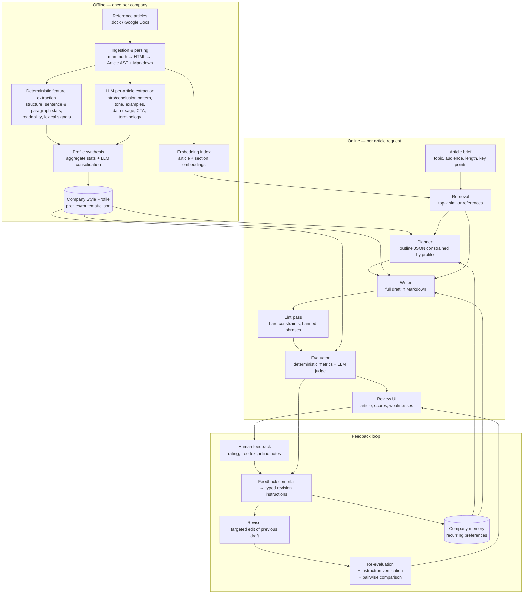
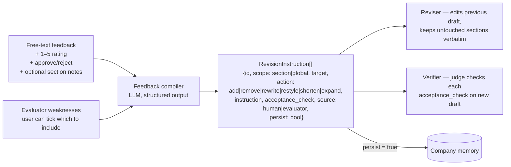

# Architecture — VRYSE AI Blog Writing System

This document explains how the system is built, how data moves through it, and why each component exists. For setup and usage, see [README.md](README.md). For the build order, see [plan.md](plan.md).

---

## 1. Design principles

1. **Analyse once, reuse many times.** Reference articles are analysed once into a **Company Style Profile**. Generation reads that profile, plus short targeted excerpts from the references. It never reads the raw corpus.
2. **Measure deterministically where possible; use an LLM only where necessary.** Word counts, heading counts, sentence lengths and readability are computed in code, so they are cheap, reproducible and free of judge noise. The LLM judge scores only what code can't measure: tone, specificity, relevance and requirement coverage.
3. **The same yardstick for generation and evaluation.** The numeric targets the writer is given (for example, "6–8 H2 sections, 1,400–1,900 words") are the same numbers the evaluator scores against. When the evaluator finds a gap, it maps directly to a fix.
4. **Feedback becomes structured edits, not appended prose.** Human feedback is compiled into typed revision instructions. Each one is verified as addressed or not addressed after the next iteration.
5. **Use a small pipeline, not an agent swarm.** The steps are fixed and their order is known, so a deterministic pipeline is used. LLM calls happen inside steps, and no agent picks the next step. This keeps behaviour, cost and debugging predictable.

---

## 2. High-level flow



---

## 3. Components

### 3.1 Ingestion and parsing (`src/lib/ingest/`)

| Input | How it is read |
|---|---|
| The client's tab in the sheet (e.g. `Routematic`) | Google Sheets API (`googleapis`), or a CSV export, gives the article titles, metadata and doc links |
| Linked Google Docs | Drive API export as `.docx`. Fallback: manual download into `data/raw/routematic/` |
| Local `.docx` files | `mammoth` converts them to semantic HTML, which `node-html-parser` then parses |

`mammoth` maps Word paragraph styles (`Title`, `Heading 1–3`, list styles) to `h1–h3`, `ul` and `ol`, and keeps tables, bold runs and hyperlinks. A custom style map covers any non-standard style names the documents use. The parser walks the resulting HTML in order and builds an **Article AST**:

```text
Article
 ├─ title, meta (source, url, date, keyword if present in sheet)
 ├─ blocks[]: Heading(level, text) | Paragraph(text, inline_marks) | List(ordered, items) | Table(rows) | Quote
 └─ markdown (rendered from blocks — single canonical text form)
```

Some Google Docs use bold paragraphs instead of heading styles. The parser normalises these with heuristics: a short bold line followed by body text is treated as a heading. This is a known source of noise and is listed in the README's limitations.

### 3.2 Style analysis (`src/lib/analysis/`)

The analysis has two parts, and they are kept separate on purpose.

**A. Deterministic features (per article, pure TypeScript)**

Sentences and words are split with the built-in `Intl.Segmenter`. Syllable counts, used for the readability formulas, come from the `syllable` package.

| Group | Features |
|---|---|
| Length | words, sections, paragraphs |
| Structure | H1/H2/H3 counts, H3-per-H2 ratio, heading word length, heading style (question vs statement vs "How to…"), FAQ section present, conclusion heading present, key-takeaways/TL;DR present, table/list counts |
| Paragraphs | words per paragraph (mean, p90), sentences per paragraph, one-sentence-paragraph rate |
| Sentences | words per sentence (mean, std), question rate, sentence-start diversity |
| Readability | Flesch Reading Ease, Flesch-Kincaid grade (implemented in `readability.ts`) |
| Lexical | top distinctive n-grams compared with a general-English baseline, brand/product mention rate, second-person ("you") rate, first-person-plural ("we") rate, numbers per 1,000 words, links per 1,000 words |
| Intro / Conclusion | intro word count (text before the first H2), conclusion word count, whether the conclusion contains a CTA |

The features are aggregated across the corpus into **distributions** (p10, p25, median, p75, p90), not single averages. That gives the evaluator a band to score against.

**B. LLM per-article extraction (cheap model, structured output)**

For each article, the model returns a validated JSON object:

```json
{
  "intro_pattern": "problem statement → stakes → what this article covers",
  "conclusion_pattern": "recap → product tie-in → CTA",
  "tone": ["practical", "authoritative", "operations-focused"],
  "audience": "HR, admin and facilities heads at Indian enterprises",
  "example_usage": "client case results and city-specific scenarios, 1–2 per article",
  "data_usage": "cites commute and traffic statistics and compliance rules, often in tables",
  "terminology": ["employee transport", "route optimisation", "rostering", "escort trips"],
  "product_mentions": "Routematic named in conclusion and 1 body section",
  "distinctive_devices": ["bulleted 'key capabilities' lists", "bold lead-in phrases"]
}
```

**C. Profile synthesis**

Stage A's statistics are combined with Stage B's per-article extractions. One LLM consolidation call reduces the extractions to their consensus patterns and records how often each pattern occurs (for example, "FAQ section: 64% of articles"). The output is `profiles/routematic.json`, a versioned **Company Style Profile**:

```text
CompanyStyleProfile
 ├─ structure:    targets + bands (sections, H3 use, FAQ rate, intro/conclusion length …)
 ├─ style:        sentence/paragraph bands, readability band, POV, formatting conventions
 ├─ voice:        tone descriptors, audience, formality, do / don't rules
 ├─ vocabulary:   signature terms, product names, phrases to avoid (incl. generic AI-isms)
 ├─ content:      example usage, data/statistics usage, citation style
 ├─ patterns:     intro templates, conclusion templates, CTA templates
 └─ provenance:   article ids, corpus size, build timestamp, profile version
```

The profile is built once and cached. The UI shows it as the system's "understanding of the company".

### 3.3 Retrieval (`src/lib/retrieval/`)

- **What is embedded:** each article's title plus summary, and each H2 section separately.
- **Model:** `Xenova/bge-small-en-v1.5`, run locally with `@huggingface/transformers` (transformers.js on ONNX Runtime). It is **free**, needs no API key or rate-limit budget, and is deterministic. The model downloads once (about 30 MB) and is cached.
- **Store:** a `Float32Array` matrix with an ID list, saved as JSON or binary under `data/index/`. At about 70 articles and about 600 sections, brute-force cosine similarity takes under a millisecond, so a vector database would add operational weight for no benefit. Swapping in pgvector later only means changing one interface.
- **Query:** the brief's topic and key points. Results are the top-3 articles, plus top-ranked sections matched to each planned outline section. Hybrid scoring: cosine and BM25 are each min-max normalised per query, then weighted 0.7 / 0.3. At 0.8 / 0.2 a keyword query ("monsoon flooding rerouting") ranked the only two sections that mention monsoons at #9; at 0.7 the first one is #2, while semantic briefs keep a relevant section first. BM25 is a small in-house implementation of about 50 lines in `bm25.ts`.
- **How results are used:** only **excerpts** go into the prompts: one intro, one conclusion and 1–2 body sections from the nearest articles. They act as voice exemplars, not as sources to copy. The writer is told never to reuse sentences from them, and the lint pass flags long n-gram overlaps.

### 3.4 Generation (`src/lib/generation/`)

Generation is **outline-first**, which makes structure controllable and easy to evaluate.

1. **Planner** (1 call, structured output). Inputs: the brief, the profile's structure targets, the retrieved section headings, and company memory. Output: an `Outline` containing the title, intro plan, sections (heading, intent, key points to cover, target words, whether an example, data point or list is needed), FAQ items if the profile calls for them, and a conclusion/CTA plan. Each required key point from the brief is mapped to a section. This mapping later drives the completeness check.
2. **Writer** (1 call). Inputs: the outline, the voice/style/vocabulary sections of the profile, the retrieved excerpts and company memory. Output: the full article in Markdown. A single call keeps voice consistent across sections at blog lengths of 1–3k words. Section-by-section writing is available behind a flag for longer pieces.
3. **Lint pass** (no LLM). Checks length, heading count, banned phrases, n-gram overlap with references and broken Markdown. If a *hard* constraint fails, such as a word count outside ±25% or a missing required section, the system makes **one** automatic repair call before evaluation.

The system prompt and profile are stable across calls, so they are placed first. That lets the provider **prompt-cache** them where it supports caching. OpenAI and Gemini cache long repeated prefixes automatically, and the wrapper also sets Anthropic cache control in case a Claude model is used later.

### 3.5 Evaluation (`src/lib/evaluation/`)

Evaluation is a hybrid. Each dimension gets a 0–100 score, plus evidence and suggestions.

| Dimension | Weight | Deterministic component | LLM-judge component |
|---|---|---|---|
| **Structure** | 20% | H2/H3 counts, intro and conclusion length, FAQ/list/table presence vs profile bands | Logical flow; whether the intro and conclusion follow the profile patterns |
| **Style** | 20% | Sentence/paragraph-length bands, POV rates, signature-term use, AI-ism hits, embedding similarity to the company centroid | Voice match against the profile's do/don't rules |
| **Relevance** | 15% | Embedding similarity of brief to article | Stays on topic and serves the stated audience |
| **Completeness** | 15% | Word count vs target; required sections present | Each brief key point checked as covered, partial or missing, with a quote as evidence |
| **Tone** | 10% | — | Matches the profile's tone descriptors |
| **Readability** | 10% | Flesch-Kincaid grade vs profile band | Clarity, with no jargon left unexplained for the audience |
| **Specificity / Quality** | 10% | Numbers and examples per 1k words vs profile | Generic-ness: highlights passages that "could appear on any company's blog" |

**Band scoring for deterministic features.** If the value falls inside the profile's p10–p90 band, the score is 100. Outside it, the score decays linearly and reaches 0 at a distance of one IQR beyond the band. Each feature's score is averaged into its dimension.

**LLM judge.** The judge comes from a different model *family* from the writer (Gemini judging GPT), which reduces self-preference bias. It works from an anchored 1–5 rubric per dimension and must quote evidence for every score. It runs at temperature 0, and the version label is hidden from it. Its 1–5 score maps to 0–100. Each dimension combines the two parts: `dimension = 0.5 × deterministic + 0.5 × judge`. Tone uses the judge alone.

**Overall score.** The weighted sum of the dimensions. A missing required section caps the overall score at 70.

**Qualitative output.** Each evaluation also returns: strengths, weaknesses (ranked), missing items, generic passages (with quotes), structural differences from the references, and specific recommendations. Each recommendation names its target (a section or the whole article).

**Judging the before/after pair.** On revisions, a separate **pairwise** judge call compares v(n) and v(n+1) with their order randomised. It answers "which better satisfies the brief and the company style, and why". This gives a second improvement signal that doesn't depend on calibrated absolute scores.

**Improvement verdict.** An iteration counts as **Improved** only when all three conditions hold:

1. The overall score rises by at least the **noise threshold**. The threshold is measured empirically by running the judge 3× on the same article (target: about +3 points).
2. No dimension drops by more than 5 points.
3. At least 80% of the revision instructions are verified as addressed.

If some conditions hold and others don't, the verdict is **Mixed**. If the overall score falls, it is **Regressed**. The pairwise result is shown next to the verdict.

**Calibration (does the metric measure anything?)**
- *Held-out human articles* (excluded when the profile was built) should score high.
- *A baseline generic article* (the same brief, written by the model with no profile) should score noticeably lower.
- If both hold, the evaluator separates on-brand from generic content. These numbers are reported in the README.

### 3.6 Human feedback and revision (`src/lib/feedback/`)



- **Why compile the feedback first?** Raw feedback like "too salesy, and the intro drags" is ambiguous. Compiled instructions such as `{scope: global, action: restyle, instruction: "limit product mentions to conclusion + 1 body section"}` and `{scope: section, target: "intro", action: shorten, instruction: "≤120 words, lead with the problem"}` can be acted on and checked. The UI shows the compiled list so the reviewer can confirm or edit it before the rewrite runs.
- **Revise or regenerate.** The default is a **targeted revision**: the reviser gets the previous draft and the instructions, and it must leave untouched sections unchanged. This keeps what was already good and makes the diff readable. A "regenerate from outline" option exists for feedback that changes the structure.
- **Memory.** An instruction marked `persist` is a general preference, such as "never use the phrase 'in today's digital landscape'". It is saved to company memory and goes into future planner and writer prompts as part of the profile overlay. The UI lets the user view and delete memory entries.

### 3.7 Persistence (`src/lib/db/`)

SQLite, through `better-sqlite3` with the **Drizzle ORM**: a single file with no extra service, and typed queries. To deploy, the same Drizzle schema can point at Postgres (Neon) by switching the driver.

| Table | Purpose |
|---|---|
| `articles` | Parsed reference articles (AST JSON, markdown, metadata) |
| `profiles` | Versioned style profiles per company |
| `runs` | A generation session: brief, company, profile version |
| `iterations` | Draft n for a run: outline, markdown, parent iteration, revision instructions applied |
| `evaluations` | Per-iteration scores, dimension breakdown, qualitative JSON |
| `feedback` | Human rating, free text, approve/reject, compiled instructions |
| `memory` | Persisted company preferences |
| `llm_calls` | Stage, model, tokens in/out, cache hits, latency, cost estimate, status/error |

### 3.8 LLM client (`src/lib/llm/`)

Every model call goes through the **Vercel AI SDK**, which makes the system provider-agnostic. A model is just a `"provider/model"` string in an environment variable. One wrapper, `llm/call.ts`, handles every call and provides:
- **Structured output:** the SDK's structured-output API with **Zod** schemas. A response that fails validation is retried once, with the validation error included.
- **Retries** with exponential backoff on 429 and overload errors. This matters most on free tiers.
- **Prompt caching** of the stable prefix, through provider options.
- **A dev response cache:** responses are keyed by a hash of (model, prompt, schema), so rerunning a step during development costs nothing.
- **Logging** of every call to `llm_calls`: tokens, latency, cost from the gateway's price list, and any error.

**Model routing (`llm/models.ts`).** By default, model strings go to the **Vercel AI Gateway**, which needs one key and gives $5 of free credit every 30 days. The free tier only allows **some** models: on 2026-10-12, every Claude model and the newest Gemini models (3.x) were blocked, while the GPT-4.1/GPT-5 families and Gemini 2.5 Flash were allowed. `pnpm vryse ping` checks the configured models. Two prefixes route around the gateway for fully free use: `google-direct/…` calls the Gemini API free tier directly, and `ollama/…` calls a local model. No pipeline code changes either way.

Each stage's model is set by an environment variable. The defaults are chosen to fit within the free gateway credit:

| Stage | Default model | Price per 1M tokens (in / out)* | Reason |
|---|---|---|---|
| Per-article extraction, feedback compiling | `google/gemini-2.5-flash-lite` | $0.10 / $0.40 | High-volume, well-scoped extraction; nearly free |
| Profile synthesis, planner, writer, reviser | `openai/gpt-5-mini` | $0.25 / $2.00 | A strong reasoning writer at a low price. Try `openai/gpt-5` or `openai/gpt-4.1` for the final demo if the writing needs more polish |
| Judge (absolute, pairwise, verification) | `google/gemini-2.5-flash` | $0.30 / $2.50 | A **different model family** from the writer, to reduce self-preference bias; cheap enough to run three times for the noise test |

\*AI Gateway list prices on 2026-10-12. Check `https://ai-gateway.vercel.sh/v1/models` for current prices.

### 3.9 UI and app layer (`src/app/`)

**Next.js (App Router) with TypeScript, Tailwind and shadcn/ui.** The pipeline lives in `src/lib/` and runs only on the server. Pages are React Server Components that read SQLite directly. Interaction uses two mechanisms:

- **Route Handlers that stream progress.** `POST /api/runs` and `POST /api/runs/[id]/revise` run the multi-step pipeline on the Node.js runtime. They stream NDJSON events back to the client (`{stage: "plan", status: "done"}`, and so on), so the UI shows live progress through retrieve → plan → write → lint → evaluate. A full run takes 30–90 s, so live progress makes the wait readable.
- **Server Actions** for quick mutations: saving feedback, editing compiled instructions, approving a draft, and deleting a memory entry.

| Page (route) | Shows |
|---|---|
| **Company** `/company/[slug]` | Corpus stats and the style profile (with distributions), plus a button to rebuild the profile |
| **New article** `/articles/new` | Brief form (topic, audience, target length, key points, required sections, notes), then Generate with live stage progress |
| **Review** `/runs/[id]` | Rendered article (`react-markdown`) · overall score and dimension bars · weaknesses and recommendations · feedback form · Compile → editable instructions → Revise |
| **Compare** `/runs/[id]/compare?a=1&b=2` | Side-by-side v(n) / v(n+1) with a word-level diff (`diff` package) · score deltas per dimension · instruction checklist (✓/✗) · pairwise verdict |
| **Memory** `/memory` | Persisted preferences (delete/edit) |
| **Observability** `/observability` | LLM calls per run: tokens, latency, cost, failures |

`better-sqlite3` and `@huggingface/transformers` are native or ONNX packages, so they are listed in `serverExternalPackages` in `next.config.ts`.

A CLI (`scripts/cli.ts`, built with `commander` and run with `tsx`) exposes the same `src/lib` pipeline for scripted work: `pnpm vryse ingest | profile | generate | evaluate | calibrate | export`.

---

## 4. Cost and latency (per article)

| Step | LLM calls | Est. cost with default models |
|---|---|---|
| Profile build (one-time) | N + 1 (N ≈ 70 Flash-Lite + 1 GPT-5 mini) | ≈ $0.06. Cached on disk; rebuild only when the corpus changes |
| Retrieval | 0 | $0 (local embeddings) |
| Plan + write | 2 (GPT-5 mini) | ≈ $0.025, including reasoning tokens |
| Lint repair | 0–1 | Only on hard-constraint failure |
| Evaluate | 1 (Gemini 2.5 Flash) | ≈ $0.01. Deterministic metrics are free |
| Each revision cycle | 1 compile + 1 revise + 1 evaluate + 1 pairwise | ≈ $0.04 |

That comes to about **$0.08 for a full generate → evaluate → feedback → revise → re-evaluate loop**. The whole project should cost roughly $1–2, comfortably inside the free **$5 per 30 days** of AI Gateway credit. That covers the profile build, calibration on about 7 held-out topics (≈ $0.50), the demo, and development. These are estimates from list prices; the real numbers come from `llm_calls` (`pnpm vryse cost`) and are reported in the README.

The context per writer call is bounded: profile (~2k tokens), excerpts (~2–3k), outline (~1k) and memory. It doesn't grow with the corpus.

**Parallelism.** Per-article extraction runs concurrently with bounded concurrency. The deterministic metrics and the judge call run in parallel. The pairwise judge and the absolute re-evaluation also run in parallel.

---

## 5. Reliability and observability

- Every LLM call is logged with its stage, model, tokens, latency, cost estimate and error. The observability page aggregates them.
- Validation failures, retries and repair calls are counted per run, and a high count signals prompt drift.
- Quality is tracked per run: overall score per iteration, number of iterations to approval, and the distribution of human ratings.
- Failures are isolated. If the judge fails, deterministic scores are still shown and the judge part is marked "unavailable" instead of failing the whole run.

---

## 6. Why not…

| Alternative | Why it wasn't chosen |
|---|---|
| **Stuffing all references into the prompt** | The brief forbids it. It is also expensive, ignores the profile, and encourages copying |
| **A multi-agent framework** (LangGraph, CrewAI) | The steps run in a fixed order. A plain pipeline is easier to debug and explain, and no step needs autonomous tool choice |
| **A vector DB** | ~70 docs. Brute-force cosine over a `Float32Array` is faster and has no operational cost |
| **Paid embedding API** | Local transformers.js is free, has no rate limits, and its quality is plenty for ranking about 70 documents |
| **Separate Python backend** | One TypeScript codebase is simpler to run and explain. The NLP work needed here (segmentation, readability, BM25, embeddings) all has solid JS options |
| **Fine-tuning on the corpus** | Too little data, too slow for a 3-day scope, and it hides *why* the output matches. An explicit profile is inspectable and editable |
| **An LLM-only evaluation** | Noisy and self-biased. Deterministic metrics anchor the scores and make improvements reproducible |
