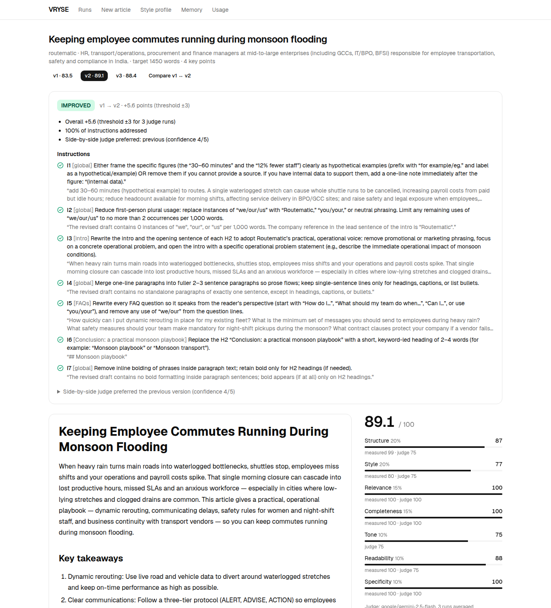
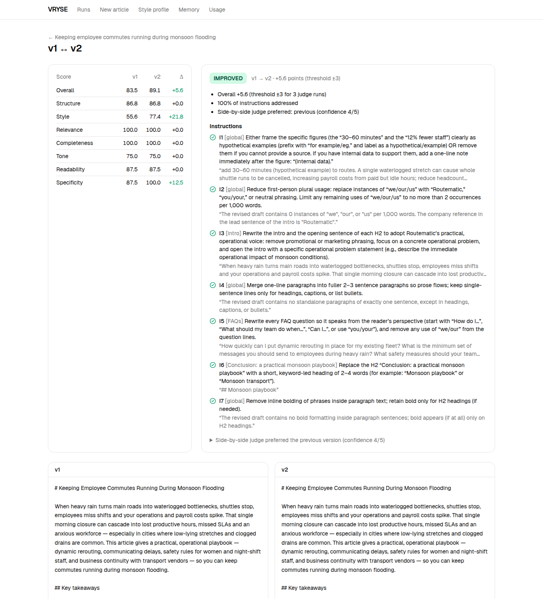

# VRYSE — AI-Powered Blog Writing System

The system learns a company's blog style from its existing human-written articles. It then writes new on-brand articles, scores them on seven dimensions, and improves them through human feedback, with a verdict on whether each revision is a measurable improvement.

**Client used:** **Routematic** (employee transport, India). Its 61 human-written blog articles were downloaded as `.docx` from the "Article Status" sheet. The brief suggested Protecto AI, but those Google Docs were access-restricted, and VRYSE confirmed that any client's articles may be used. Nothing in the code is Routematic-specific.

**Headline results** (all measured; details in §8 and §10):
- **Calibration:** on 6 held-out articles, real Routematic articles score **85.5**, a generic AI article on the same brief **70.0** (77.0 uncapped), and this system **87.0**. The scores separate on-brand writing from generic writing, and the system matches the human articles within noise.
- **Before/after:** one brief, two feedback cycles, 3 judge runs per score. **83.5 → 89.1 (IMPROVED, +5.6 against a 3-point noise threshold) → 88.4.** All 10 instructions were verified as done.
- **Cost:** about **$0.03–0.05 per article** and **$0.05 per feedback cycle**. The whole project, including every experiment, cost **$1.33** of free AI Gateway credit.



---

## Contents

1. [Overview](#1-overview)
2. [Architecture](#2-architecture)
3. [Technology choices](#3-technology-choices)
4. [Setup](#4-setup)
5. [Environment variables](#5-environment-variables)
6. [Running the application](#6-running-the-application)
7. [Using the application](#7-using-the-application)
8. [Evaluation methodology](#8-evaluation-methodology)
9. [Design decisions](#9-design-decisions)
10. [Before & after example](#10-before--after-example)
11. [Known limitations](#11-known-limitations)
12. [Future improvements](#12-future-improvements)

Further reading: [ARCHITECTURE.md](ARCHITECTURE.md) (components, data flow, formulas), [plan.md](plan.md) (the build log, step by step, with every problem found and how it was fixed), [docs/PROGRESS.md](docs/PROGRESS.md) (a plain-language walkthrough).

---

## 1. Overview

| Stage | What it does | Output |
|---|---|---|
| **1. Analysis** | Parses the reference `.docx` files. Measures **37 features per article in code** (structure, rhythm, readability, lexical rates, section order) and has an LLM describe each article's intro and conclusion moves, tone, use of data and examples, and terminology. Both are consolidated into a profile | **Company Style Profile** (`data/profiles/routematic.json`) |
| **2. Generation** | Retrieves similar reference sections (hybrid embedding + BM25 search), **plans an outline that code checks** against the brief and the profile, writes the article from the outline and voice excerpts, and lints it (length, structure, invented links, copied passages, unsupported figures), with one repair if needed | Markdown article |
| **3. Evaluation** | Scores 7 dimensions, each combining **code-measured** features (against the company's real ranges and embedding closeness) with an **anchored-rubric LLM judge** that quotes evidence and lists unsupported claims. Weaknesses are ranked, each with a fix | Scores and qualitative report |
| **Feedback loop** | Turns a reviewer's rating, notes and ticked weaknesses into **typed instructions with acceptance checks**, which the reviewer can edit. Revises only the targeted sections, re-scores, **verifies each instruction**, runs a **randomised side-by-side comparison**, and gives a verdict | New version, ✓/✗ checklist, verdict, diff |

## 2. Architecture

```text
Reference .docx ─► Parse ─► 37 measured features ──┐
                        └─► LLM per-article traits ─┴─► Company Style Profile ─────────────┐
                        └─► Section chunks ─► local embeddings + BM25 index ─┐             │
                                                                             ▼             ▼
Brief ─► Retrieve similar articles ─► Plan outline ─► code checks (re-plan once) ─► Retrieve per section
      ─► Write ─► Lint (one repair) ─► Evaluate: measured + judge (×3) ─► Review UI
                                                                              │
             Company memory ◄── your general rules ◄── Compile feedback ◄─────┘ rating, notes, ticked weaknesses
                                                              │ (editable instructions)
                                     Revise targeted sections ─► Lint ─► Evaluate ║ Verify ║ Compare A/B ─► Verdict
```

A fixed pipeline, not autonomous agents: the order of steps never changes, so a pipeline is cheaper, predictable and easy to debug. Every LLM call goes through one wrapper that handles schema validation (with one retry), backoff, a concurrency limit, a dev response cache, a **hard spending cap**, and per-call cost and latency logging. See **[ARCHITECTURE.md](ARCHITECTURE.md)** for the full design.

### Repository layout

```text
.
├── README.md · ARCHITECTURE.md · plan.md · docs/PROGRESS.md · docs/images/
├── scripts/cli.ts                    # `pnpm vryse …` (all pipeline commands)
├── src/
│   ├── app/                          # Next.js App Router: pages + streaming API routes
│   ├── components/                   # UI (shadcn/ui on Base UI) and app components
│   └── lib/                          # the pipeline (server-only)
│       ├── llm/                      # AI SDK wrapper: validation, retries, cache, cost log, budget cap
│       ├── ingest/                   # .docx → blocks → Markdown, dedupe, train/test split
│       ├── analysis/                 # 37 features, bands, section order, terms, LLM traits, profile
│       ├── retrieval/                # chunking, local embeddings, BM25, hybrid search, excerpts
│       ├── generation/               # style guide, planner + outline checks, writer, lint, reviser
│       ├── evaluation/               # bands, measured scores, embeddings, judge, pairwise, verify,
│       │                             #   verdict, noise, calibration
│       ├── feedback/                 # feedback compiler, standing-rule gate, memory
│       ├── prompts/*.md              # every prompt, versioned as Markdown
│       ├── db/                       # Drizzle schema + SQLite client
│       ├── pipeline.ts               # runGeneration, runRevision, re-evaluation
│       └── export.ts                 # before/after export
├── drizzle/                          # SQL migrations (applied automatically)
├── data/
│   ├── profiles/routematic*.json     # the style profile and corpus statistics (committed)
│   ├── calibration/                  # noise and calibration results (committed)
│   └── raw/ processed/ index/ runs/  # client documents and generated data (git-ignored)
├── examples/briefs/                  # three example briefs
├── examples/before_after/            # the exported demo run (§10)
└── tests/                            # 170 Vitest tests (LLM calls mocked)
```

## 3. Technology choices

| Concern | Choice | Why |
|---|---|---|
| Language / runtime | **TypeScript** on Node.js 24 | One language for the pipeline, API and UI, with typed schemas end to end |
| App | **Next.js 16** (App Router) | Server components read the DB directly, route handlers stream pipeline progress, and server actions handle small mutations. No separate backend |
| LLM access | **Vercel AI SDK 7** via the **Vercel AI Gateway** | Provider-agnostic `provider/model` strings. One key gives OpenAI and Google models, plus **$5 of free credit every 30 days** |
| Models | GPT-5 mini (planner, writer, reviser, profile synthesis, feedback compiler) · Gemini 2.5 Flash, thinking off (judge, verifier, pairwise) · Gemini 2.5 Flash-Lite (per-article extraction) | All on the gateway free tier. **The judge is from a different company than the writer**, to reduce self-preference bias. Each choice was tested (§9) |
| Structured output | **Zod** schemas | Every LLM output and API input is validated |
| Document parsing | `mammoth` + `node-html-parser` | Keeps Word heading, list, table, bold and link structure, which the analysis depends on |
| Text metrics | `Intl.Segmenter` + `syllable` | Built-in segmentation; readability formulas implemented and tested in-house |
| Embeddings | `@huggingface/transformers` (local `bge-small-en-v1.5`) | Free, no rate limits, deterministic. Runs on CPU |
| Search | Cosine over `Float32Array` + in-house BM25 | 457 chunks don't need a vector database |
| Storage | SQLite (`better-sqlite3`) + **Drizzle ORM** | A single file with auto-applied migrations. The schema can move to Postgres |
| UI | Tailwind + **shadcn/ui**, `react-markdown`, `diff` | Clean components, Markdown rendering and word-level diffs |
| Tests | **Vitest** with the AI SDK's mock models | 170 tests, no network calls |

## 4. Setup

**Prerequisites:** Node.js 22+ (24 recommended), `pnpm` (`corepack enable pnpm`), and a free Vercel account for an AI Gateway key.

```bash
git clone <repo-url> vryse && cd vryse
pnpm install
cp .env.example .env.local     # then paste your AI_GATEWAY_API_KEY
pnpm vryse ping                # checks the three configured models; creates data/vryse.db
```

**AI Gateway key:** in the Vercel dashboard, open **AI Gateway → API Keys** and create a key. The free tier allows only some models; on 2026-10-12 every Claude model and Gemini 3.x were blocked. `pnpm vryse ping` shows whether the configured models work. Buying credits ends the free monthly grant.

### Reference articles

The client's articles are **not committed**, because they're client content. Download the Routematic articles marked "Doc Ready" in the "Article Status" sheet as `.docx` (*File → Download → Microsoft Word*) into `data/raw/routematic/`. Then:

```bash
pnpm vryse ingest --company routematic --from-dir data/raw/routematic      # parse, dedupe, split 90/10
pnpm vryse profile build --company routematic --brand Routematic           # stats + LLM profile + search index (~$0.03)
```

The resulting profile and corpus statistics are committed in `data/profiles/`, so you can read what the system learned without running anything.

## 5. Environment variables

| Variable | Default | Purpose |
|---|---|---|
| `AI_GATEWAY_API_KEY` | — (**required**) | Vercel AI Gateway access |
| `VRYSE_ANALYSIS_MODEL` | `google/gemini-2.5-flash-lite` | Per-article trait extraction |
| `VRYSE_WRITER_MODEL` | `openai/gpt-5-mini` | Profile synthesis, planner, writer, reviser, feedback compiler |
| `VRYSE_JUDGE_MODEL` | `google/gemini-2.5-flash` | Judge, instruction verifier, pairwise comparison |
| `VRYSE_JUDGE_THINKING_BUDGET` | `0` | Judge thinking tokens. Off cut judge noise from σ 4.6 to 1.6 (§8) |
| `VRYSE_JUDGE_RUNS` | `3` | Judge runs averaged per evaluation. Use 1 while developing to save credit |
| `VRYSE_JUDGE_SIGMA` | `1.63` | Measured single-run judge σ; the improvement threshold is derived from it |
| `VRYSE_BUDGET_USD` | `3` | **Hard cap**: no new paid calls once the logged total reaches this |
| `VRYSE_LLM_CONCURRENCY` | `6` | Maximum parallel LLM calls |
| `VRYSE_DEV_CACHE` | `true` | Reuse identical LLM answers (the judge is never cached) |
| `VRYSE_EMBED_MODEL` | `Xenova/bge-small-en-v1.5` | Local embedding model |
| `VRYSE_DATA_DIR` / `VRYSE_DB_PATH` | `./data` / `./data/vryse.db` | Data folder and SQLite file |
| `GOOGLE_GENERATIVE_AI_API_KEY`, `OLLAMA_BASE_URL` | — | Only for `google-direct/…` or `ollama/…` model strings (routing supported, not used here) |

## 6. Running the application

```bash
pnpm dev                       # web UI at http://localhost:3000
```

Everything is also available from the CLI:

| Command | What it does | AI cost |
|---|---|---|
| `pnpm vryse generate --brief examples/briefs/ev-fleet-transition.json` | Retrieve → plan → write → lint → evaluate; prints scores and weaknesses | ~$0.03–0.05 |
| `pnpm vryse weaknesses --run <id> [--version n]` | Numbered weaknesses of a version | free |
| `pnpm vryse revise --run <id> --rating 3 --weaknesses 1,3 --feedback "…" [--mode regenerate]` | One feedback cycle with verdict | ~$0.03–0.05 |
| `pnpm vryse evaluate --run <id> [--version n]` | Re-score a saved version | ~$0.008 per judge run |
| UI only: `/runs/<id>/compare?a=1&b=2` | Score deltas and side-by-side word diff | free |
| `pnpm vryse export --run <id> --out <dir>` | Brief, versions, evaluations, revisions, diffs and summary | free |
| `pnpm vryse memory --company routematic [--forget <id>]` | Saved standing rules | free |
| `pnpm vryse noise --run <id> --times 5` | Measure judge noise on one draft | ~$0.04 |
| `pnpm vryse calibrate --company routematic` | Human vs generic vs system on held-out articles | ~$0.60 |
| `pnpm vryse cost` | Logged spend and remaining gateway credit | free |
| `pnpm test && pnpm typecheck && pnpm lint` | 170 tests, types, lint | free |

## 7. Using the application

1. **Style profile:** see what was learned: voice, typical outline, measured ranges, counted intro patterns, do/don't rules and phrases to avoid.
2. **New article:** enter a topic. Optional fields are keyword, length, audience, key points, required sections and notes; empty ones come from the profile. Each stage ticks off live (about 1 minute).
3. **Review:** the article, the overall score, 7 dimension bars (each showing its measured and judged halves), key-point coverage, the judge's summary and its quoted unsupported claims.
4. **Feedback:** tick the weaknesses you agree with, give a 1–5 rating, write notes, and press **Compile**. Review the instructions: each has a target, an action and an acceptance check. Edit or remove any of them, then press **Revise**. General rules in your own words ("never…", "always…", "all our articles…") are saved to **Memory** and applied to future articles.
5. **Result:** the new version opens with its **verdict** (*Improved* / *Mixed* / *Regressed*), the reasons, a ✓/✗ checklist with evidence, a warning if a section changed without an instruction, and the side-by-side judge's preference.
6. **Compare:** score deltas per dimension and a word-level diff (red removed, green added).
7. **Usage:** spend per stage and model, errors and latency, against the spending cap.



## 8. Evaluation methodology

### Metrics and how they are calculated

Each dimension has a **measured** half (code, against the company's reference corpus) and a **judged** half (LLM, anchored rubric), blended 50/50 unless noted otherwise.

| Dimension | Weight | Why | Measured half | Judged half |
|---|---|---|---|---|
| Structure | 20% | Must look like the company's articles | H2 count, H3 per H2, intro and closing length, FAQ size, FAQ present, FAQ last | Flow; intro and conclusion follow the counted house patterns |
| Style | 20% | The core requirement: not generic | 10 rhythm and formatting features (sentence and paragraph length and variation, one-sentence-paragraph rate, opening variety, you/we rates, bold, links, AI-phrase rate) **plus embedding closeness to the company centroid**, scored against how close the real articles are | Voice and do/don't rules |
| Relevance | 15% | Must answer the brief | Article-to-brief similarity, scored against how close the reference articles are to the same brief | On topic, serves the audience |
| Completeness | 15% | Required content | Length against target (100 within ±10%, 0 at ±50%) and required sections | Each key point covered / partial / missing, with a quote (60% of the dimension) |
| Tone | 10% | Brand voice | — | Matches the profile's tone (100%) |
| Readability | 10% | Fit for the audience | Flesch-Kincaid grade and reading ease against the corpus range | Clarity |
| Specificity | 10% | Generic filler and invented facts are the typical AI failures | Numbers per 1,000 words; **−10 per figure found in neither the corpus nor the brief** | Generic passages; **claims not supported by the source passages** |

- **Range ("band") scoring:** 100 inside the corpus's p10–p90 band, falling linearly to 0 at one interquartile range outside it, optionally penalising one side only (for example, AI-phrase rate).
- **Overall score:** the weighted sum. It's capped at 70 if a required section or the FAQ (present in 100% of Routematic articles) is missing. If the judge fails, measured scores are used and the weights rescaled.
- **The judge:** Gemini 2.5 Flash, a different company from the GPT writer. It works from a 1/3/5-anchored rubric, quotes evidence for every score, sees the source passages the writer saw, runs at temperature 0 with thinking off, is never told which version it's reading, and is never answered from the cache.
- **Human rating:** stored with the feedback and given to the instruction compiler. It's deliberately **not** mixed into the automatic score, so scores stay comparable across runs.

### How improvement is determined

A revision is **IMPROVED** only if all three hold:
1. **Overall Δ ≥ the noise threshold**, 2·√2·σ/√k rounded up to a half point. With the measured σ = 1.63, that's **3 points with 3 judge runs** and 5 with 1, using whichever side had fewer runs.
2. **No dimension falls by more than 5 points.**
3. **At least 80% of the instructions are verified as done** by the judge against their acceptance checks.

It's **REGRESSED** if the overall score falls by at least the threshold, and **MIXED** otherwise. Two more safeguards:
- An independent **side-by-side judge** (order randomised and mapped back) gives its preference and reasons.
- If the previous version was scored with different judge settings, it's **re-scored first**, so the comparison is like for like.

### Judge noise (measured)

The same draft was scored 5 times. The measured half was identical every time, so all the variance is the judge's.

| Judge | σ, single run | Decision |
|---|---|---|
| Gemini 2.5 Flash, default thinking | 4.6 and 5.5 | Too noisy: a +13 threshold |
| **Gemini 2.5 Flash, thinking off** | **1.6 and 0.0** | **Chosen**: still critical, a third of the noise, cheaper |
| Mistral Large 3 | 0.6 | Rejected: steady but lenient (5/5 specificity despite quoted unsupported claims) |

Data: [`data/calibration/noise.json`](data/calibration/noise.json)

### Calibration

Six held-out Routematic articles were never in the profile or the index. For each one, a brief was built from its title, four body headings and length. Three sets were scored on those briefs (3 judge runs each):
- the **real article**, with its own statistics trusted, since they come from the author's research;
- a **generic baseline**: the same writer model with only the brief, no profile, examples or rules;
- **this system**.

| Set | Overall | Uncapped | Structure | Style | Relevance | Completeness | Tone | Readability | Specificity |
|---|---|---|---|---|---|---|---|---|---|
| Held-out human articles | **85.5** | 85.5 | 79 | 79 | 98 | 100 | 67 | 83 | 92 |
| Generic baseline | **70.0** | 77.0 | 49 | 70 | 100 | 100 | 71 | 88 | 74 |
| This system | **87.0** | 87.0 | 87 | 70 | 100 | 100 | 75 | 97 | 84 |

- **The scores separate on-brand from generic writing.** Human beats generic by 8.5 points even uncapped, mostly on structure (79 vs 49) and specificity (92 vs 74). The generic articles never had the FAQ that every Routematic article has.
- **The system matches the human articles within noise** (87.0 vs 85.5), but doesn't beat them. **Style still prefers the human articles (79 vs 70)**, so the evaluator can tell them apart.
- **Teaching to the test:** the system is guided by the same corpus ranges it's scored on, which explains part of its structure lead and its uniformity (86–88, against the humans' 74–93).
- Relevance and completeness saturate here, because the briefs come from the articles' own headings.

Data: [`data/calibration/calibration.json`](data/calibration/calibration.json)

### Limitations of this evaluation

- The judge is an LLM. Noise is measured and controlled, but its biases (for example, sometimes rating style lower than the measured features suggest) are not removed.
- Band scores reward matching the company's *typical* article, so an unusually short or long but excellent article is penalised.
- Embedding closeness mixes topic and style.
- 54 reference and 6 held-out articles are small samples for percentile bands and calibration.
- The figure check only knows whether a number appears *somewhere* in the corpus. A common number used out of context ("30%") passes; the judge's source check is the second line of defence.

## 9. Design decisions

| Area | Decision | Why (evidence) |
|---|---|---|
| Reference analysis | **Code measures, the LLM describes, code checks the LLM.** 37 features and the section order are computed; the LLM extracts per-article traits; a second call consolidates them with counts | Code numbers are exact, free and reproducible. When the LLM inferred the section order it got it wrong (FAQ before the conclusion); measuring it in code fixed that |
| Avoid phrases | AI-style phrases the human corpus uses in under 10% of articles | "seamless" (15% of human articles) stays part of the house style; "delve" doesn't |
| Retrieval | Hybrid 0.7 embedding / 0.3 BM25, min-max normalised, section-level, excerpts only (≤2,500 tokens), one per article | At 0.8/0.2, a keyword query put the only two monsoon passages at #9 and #11; at 0.7 the first is #2, with no loss on semantic briefs |
| Generation | Outline first, **checked in code** (key points assigned, required sections, FAQ size, H2 range, conclusion last, word budget), with one re-plan; then a single-pass writer | Structure and coverage become controllable and checkable; a single pass keeps the voice consistent |
| Truthfulness | Figures and links only from the excerpts or the brief; lint blocks invented URLs and copied 12-word passages and flags unsupported figures | Found by testing: unsourced planning numbers and "(company internal data)" labels. Both are now prohibited and checked |
| Length | Writer budgets scaled by **0.78** | GPT-5 mini overshot by 29–38% in 4 of 4 runs, even with "never more than"; after calibration, +6% to +9% with no repair needed |
| Evaluation | Measured + judged per dimension, a separate pairwise judge, and instruction verification | Each catches what the others miss. In the demo, the pairwise judge caught an over-correction the absolute score rewarded |
| Judge | Gemini 2.5 Flash with thinking off, averaged over 3 runs, never cached | σ 4.6 → 1.6; Mistral was steadier but lenient (§8) |
| Feedback compiler | GPT-5 mini; one instruction per point; **editable before revising**; standing rules only if *your* wording says so | Flash-Lite invented requests and split one point into 9 instructions. The model also marked article-specific fixes as permanent, so a code gate decides |
| Revision | Targeted edit of the previous draft, with section-level change detection; "regenerate" for structural feedback | Keeps what was good and makes the diff readable |
| Cost control | Dev cache, a **hard budget cap**, 1 judge run while developing, 3 for verdicts | The whole project cost $1.33 |
| Storage | SQLite with a rollback journal and busy timeout | In WAL mode, a long-running dev server kept a stale view after CLI processes wrote to the file |
| Architecture | One Next.js app; a fixed pipeline, not agents | Simpler to run, explain and debug; no step needs autonomous tool choice |

See [ARCHITECTURE.md §6](ARCHITECTURE.md#6-why-not) for the alternatives considered.

## 10. Before & after example

The full export is in [`examples/before_after/`](examples/before_after/): the brief, every version, every evaluation, the instructions, verification results, verdicts and diffs. Every score is the mean of 3 judge runs. **The feedback was written by the developer acting as the editor.**

**Brief** (`examples/briefs/monsoon-commute-disruption.json`): "Keeping employee commutes running during monsoon flooding". It has 4 key points (dynamic rerouting, communicating delays, safety for women and night-shift staff, vendor continuity). This is a hard brief, because no reference article covers monsoons.

| Score | v1 (generated) | v2 (feedback 1) | v3 (feedback 2) | Δ v1→v3 |
|---|---|---|---|---|
| **Overall** | **83.5** | **89.1** | **88.4** | **+4.9** |
| Structure | 86.8 | 86.8 | 87.5 | +0.7 |
| Style | 55.6 | 77.4 | 75.5 | **+19.9** |
| Relevance | 100 | 100 | 100 | 0 |
| Completeness | 100 | 100 | 100 | 0 |
| Tone | 75.0 | 75.0 | 75.0 | 0 |
| Readability | 87.5 | 87.5 | 87.5 | 0 |
| Specificity | 87.5 | 100 | 95.8 | +8.3 |

**v1 → v2.**
- **Feedback:** rating 3/5, plus 4 ticked weaknesses (unsourced figures; "we" at 4.0 per 1k words against Routematic's 0–2.6; bold at 22 per 1k against 3–17; 71% one-sentence paragraphs against 10–57%). The notes:

  > *Good structure and coverage, but it doesn't sound like us yet. The '30–60 minutes' and '12% fewer staff' figures have no source: frame them clearly as hypothetical examples or cut them. Rewrite the FAQ questions from the reader's side… Rename 'Conclusion: a practical monsoon playbook' to a short keyword-led heading. Too many one-line paragraphs…*

- **Compiled:** 7 instructions, **7/7 verified ✓**. The figures were framed as examples, "we/our" went to 0, the FAQ questions were rewritten to "you", the heading was renamed, the paragraphs merged and the bold cut.
- **Verdict: IMPROVED.** +5.6 (threshold 3), no dimension drop, 100% addressed.
- **But the side-by-side judge preferred v1 (4/5)**, and its reasons were valid: the bold removal overshot (0 per 1k, below Routematic's 3–17, so lead-in bolding was lost), and "(hypothetical example)" tags read awkwardly. The two signals disagreeing is exactly what the extra judge is for.

**v2 → v3.**
- **Feedback:** rating 4/5:

  > *put bold back on the lead-in phrase of each list item… replace the '(hypothetical example)' tags with natural wording… tighten the intro to about 130 words.*

- **Compiled:** 3 instructions, **3/3 verified ✓**.
- **Verdict: MIXED.** −0.7 is within noise, and **the side-by-side judge now preferred the revision (4/5)** for its restored lead-in bolding and tighter intro.

**Net result, v1 → v3:** +4.9 overall, above the 3-point threshold. Style went from 56 to 76, and both over-corrections were repaired.

**Cost of this run:** $0.133 for 3 versions, 9 judge runs, 2 verifications and 2 pairwise comparisons.

## 11. Known limitations

- **Ingestion is manual.** `.docx` files are downloaded by hand; there's no Google Drive/Sheets connector. The parser handles real heading styles, and bold-only "headings" by heuristic.
- **Fact-grounding is partial.** Figures are restricted to the excerpts, links to known URLs, and the judge lists unsupported claims, but nothing checks facts against the web.
- **One house style per company.** Different article types (listicle, how-to, comparison) share one profile.
- **Writing to the test.** The writer is guided by the same ranges the evaluator scores, so measured style flatters the system. The judge, pairwise comparison and calibration partly offset this.
- **Instruction compiling can over-apply.** For example, "bold less" became "no bold at all". Editable instructions, the pairwise judge and a second cycle handle this, but the reviewer still needs to read the instructions.
- **Small samples.** 54 reference articles, 6 held-out articles, and one demo brief with two cycles.
- **Single-user and local.** SQLite, no authentication, no job queue. Generation runs inside the request (1–2 minutes).

## 12. Future improvements

- **Per-content-type sub-profiles** (listicle, how-to, comparison), chosen from the brief.
- **Fact grounding:** web search and citation checks for every figure, plus an "approved facts" list per company.
- **Learn the weights from humans:** fit the dimension weights to the reviewers' 1–5 ratings once enough are collected.
- **Section-level regeneration** from the Compare view, and accept/reject per instruction.
- **Better memory:** suggest a standing rule when the same feedback recurs across articles.
- **Production setup:** Postgres (Neon) via Drizzle, documents in Blob storage, generation as a durable background workflow, authentication, and OpenTelemetry traces in place of the local usage page.
